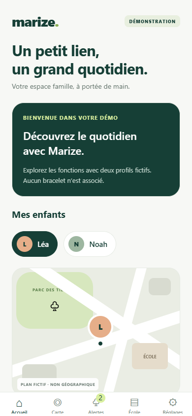

# Prototype iPhone — version 0.1

## Ce que contient cette version

Une application Expo / React Native en français : accueil, sélection entre deux enfants fictifs, carte schématique, alertes consultables, programmation du mode école par enfant et réinitialisation de la démonstration.

Toutes les données sont fictives. Le prototype ne communique avec aucun bracelet, ne collecte aucune position et ne délivre aucune notification système. Les changements restent en mémoire et disparaissent lorsque l’application est rechargée. Aucun compte utilisateur ni serveur n’est configuré.

## Lancer sur un iPhone depuis Windows

Prérequis : Node.js 22.13 ou plus récent sur la branche 22, et Expo Go pour SDK 58 sur l’iPhone. Consulter les instructions officielles d’installation : https://expo.dev/go.

Dans un terminal PowerShell à la racine du projet :

```powershell
cd mobile
npm.cmd install
npm.cmd start
```

Connecter le PC et l’iPhone au même réseau Wi-Fi. Ouvrir Expo Go sur l’iPhone puis scanner le QR code du terminal avec l’appareil photo. Si Expo demande une connexion, connecter le terminal (`npx.cmd expo login`) et Expo Go au même compte Expo. Aucun identifiant ne doit être placé dans les sources.

Cette version cible SDK 58 pour correspondre à Expo Go installé sur l’iPhone de test. Vérifier la version indiquée par Expo Go en cas de message d’incompatibilité. Documentation : https://docs.expo.dev/workflow/upgrading-expo-sdk-walkthrough/ et https://docs.expo.dev/get-started/start-developing/.

Après une mise à niveau du SDK, arrêter l’ancien serveur Metro avec `Ctrl+C`, puis le relancer depuis `mobile` en vidant son cache :

```powershell
npm.cmd start -- --go --clear
```

Scanner le nouveau QR code. Un serveur Metro resté ouvert avant la mise à niveau peut encore utiliser les anciennes dépendances.

Le message `Project is incompatible with this version of Expo Go` indique une différence entre le SDK du projet et celui d’Expo Go, même si le QR code et le réseau fonctionnent. Le projet a été migré de SDK 57 vers SDK 58 à la suite de ce message sur l’iPhone de test.

Si le QR code ne fonctionne pas, vérifier que le réseau autorise les communications entre appareils et que le pare-feu permet au serveur de développement de recevoir les connexions sur le réseau privé.

L’application s’ouvre dans Expo Go. Ce lancement ne produit pas une application autonome ni une publication App Store. Une distribution TestFlight ou App Store nécessitera une étape distincte de compilation, de signature et de configuration Apple.

## Commandes de vérification

Depuis `mobile` :

```powershell
npm.cmd test
npm.cmd run test:coverage
npm.cmd run typecheck
npm.cmd run lint
npm.cmd run export:ios
npm.cmd run test:e2e
```

Les tests métier sont automatisés. L’export iOS vérifie la création du bundle JavaScript, sans remplacer un essai sur iPhone ni une compilation native signée.

Les tests de parcours utilisent la version web de la même interface, dans Chrome (ou Edge) avec une fenêtre de 390 × 844 pixels. Ils vérifient les interactions entre écrans et l’état partagé, mais pas le comportement natif d’iOS. Le serveur local de test utilise le port 8082.

La couverture mesurée par `test:coverage` concerne uniquement la logique métier dans `src/domain/`, pas l’ensemble des composants de l’interface.

## État des dépendances

L’audit initial a signalé des vulnérabilités transitives dans l’écosystème Expo SDK 57, notamment dans le décodage d’URL de la navigation et dans les outils de développement. Les mises à jour compatibles doivent être appliquées et l’audit revérifié avant toute distribution. Un changement forcé de version majeure du décodeur peut casser Expo Router ; il ne doit pas être utilisé pour faire disparaître artificiellement les alertes.

Le prototype est destiné aux essais locaux avec des données fictives. La validation de ses dépendances pour une distribution publique reste à effectuer.

Après migration vers SDK 58, l’installation propre signale 24 alertes de sévérité modérée et aucune alerte de sévérité élevée ou critique. Les 29 alertes mentionnées dans les résultats initiaux ci-dessous concernent l’ancienne installation SDK 57.

## Vérifications initiales du SDK 57 — 3 novembre 2026

- Tests métier : 7 tests réussis ; couverture de 100 % des lignes, branches et fonctions du module métier.
- Parcours web au format mobile : 4 tests réussis, couvrant sélection d’enfant, carte, lecture et filtre des alertes, programmation école et réinitialisation.
- TypeScript et contrôle de style : réussis.
- Vérification des versions avec Expo : dépendances à jour pour le SDK sélectionné.
- Export iOS avec compilation Hermes : réussi.
- Relecture de la capture d’accueil au format 390 × 844 pixels : effectuée.
- Essai sur iPhone physique et compilation native signée : non effectués dans cet environnement Windows.
- Audit après mises à jour compatibles : 29 alertes transitives restantes, dont 5 de sévérité élevée ; elles nécessitent une résolution compatible avant distribution publique.



## Vérifications après migration SDK 58 — 3 novembre 2026

- Expo installé : 58.0.22 ; manifeste iOS d’un serveur Metro neuf : `sdkVersion: 58.0.0`.
- Dépendances alignées sur le SDK 58 ; arbre npm sans conflit de dépendances.
- Expo Doctor : 20 vérifications réussies sur 20.
- Tests métier : 7 réussis, couverture du module métier à 100 %.
- Tests de parcours web mobile : 4 réussis.
- TypeScript, contrôle de style et export iOS Hermes : réussis.
- Audit d’installation : 24 alertes modérées, aucune élevée ou critique.
- Validation de l’ouverture sur l’iPhone physique : à effectuer après redémarrage de Metro et nouveau scan.

## Parcours manuel à vérifier sur iPhone

1. Ouvrir l’accueil et vérifier le badge de démonstration.
2. Passer de Léa à Noah et vérifier que les informations affichées correspondent à l’enfant sélectionné.
3. Ouvrir la carte et vérifier le marquage fictif et l’horodatage de la position.
4. Ouvrir une alerte, la marquer comme lue et vérifier le compteur ainsi que le filtre des alertes non lues.
5. Programmer le mode école, changer d’enfant puis revenir : chaque enfant doit conserver sa configuration pendant la session.
6. Saisir un horaire invalide et vérifier le message d’erreur ; corriger puis enregistrer la simulation.
7. Annuler une réinitialisation, vérifier que les données restent présentes, puis confirmer la réinitialisation.
8. Vérifier le défilement, les zones de sécurité de l’écran, le clavier et les libellés avec VoiceOver et une taille de texte augmentée.

## Prochaines étapes

- Valider l’interface sur un iPhone physique.
- Recevoir le protocole du fabricant et tester un bracelet réel.
- Concevoir les comptes et les autorisations côté serveur.
- Remplacer les données simulées par une intégration testée.
- Ajouter les notifications et la conservation des données selon les décisions produit.
